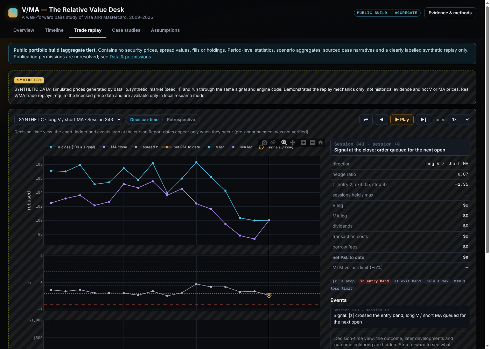

# V/MA Pairs Trading: A Walk-Forward Study

**Question.** Does the log-price spread between Visa (V) and Mastercard (MA) mean-revert tradably out of sample, after
execution timing, costs, borrow and dividends?

**Verdict: inconclusive.** Tested on CRSP data, the Visa-Mastercard pairs trade shows a modest positive Sharpe, but the result is
sensitive to execution timing and the study found no reliable edge. Final conclusion: [`docs/CONCLUSION.md`](docs/CONCLUSION.md).


*Total-equity return (cash earns nothing in the strategy's account) against T-bills on the same $1M, split into three
independent runs stitched for display: **development 2009-2017**, **validation 2018-2022** and **holdout 2023-2025** (spent).
The strategy's lead comes from the development period, when T-bill rates were near zero (+35.8% vs 0.0%). In 2018-2025
(validation plus holdout) the strategy compounded +12.9% and T-bills +24.6%; financing assumptions that could narrow that gap
are in `docs/RESULTS.md`.*

**Execution timing caveat.** The result depends on the fill. At the next open the 2018-2025 Sharpe is 0.44; at the next close
0.07, and at every later fill tested about zero (exploratory engine reruns). Three March 2020 trades account for $50.7k of the
$75.6k validation gain from opening fills. This sample does not establish a persistent opening-fill advantage.

### Detailed findings
(CRSP daily data, 2009-2025; details and caveats in [`docs/RESULTS.md`](docs/RESULTS.md))
- Net Sharpe 0.60 / 0.47 / 0.40 in development / validation / holdout, on total equity with cash earning nothing. Only the
  development period, which the design was checked on, is individually distinguishable from zero. For 2018-2025 the
  Sharpe is 0.44 (Newey-West t about 1.3).
- Against T-bill rates the as-run return is below cash in 2018-2025 (excess Sharpe -0.33); with interest on free cash it
  roughly matches cash (+0.24). These use a provisional risk-free series (`docs/RESULTS.md`).
- The result depends on execution; see the timing caveat above.
- Without its three best trades the holdout loses money. Measured over actual holding intervals, trades spanning earnings
  releases did no reliably worse (post hoc, exploratory).
- The accounting is internally consistent, independently re-derived for six complete trades and leg by leg for all 107, and
  the run fails on any discrepancy. The study is inconclusive about an economic edge. Final conclusion:
  [`docs/CONCLUSION.md`](docs/CONCLUSION.md).

**Important limitations.** One pair and about six trades per year; V and MA chosen with hindsight; execution at the opening
print with no impact model; assumed costs and borrow; every 2009-2025 year has now been examined, so none is untouched.

### More charts
Strategy-level figures only; no security prices. All are reproductions with the corrected engine; the holdout is spent.


*Same trades, only the fill price differs. The validation-period advantage of opening fills comes mostly from three March 2020
trades, and the sign is reversed in development. This sample does not establish a persistent opening-fill advantage.*


*Many small target-exit wins and a fat left tail from time and stop exits. The three best trades matter: the holdout is
negative without them.*

### Interactive research app

*The app's trade-replay tab, shown on **synthetic data** (simulated prices, labelled SYNTHETIC in the app). It is not V or MA
price data; licensed prices stay out of every public asset.*

`build_site.py` builds **V/MA - The Relative Value Desk**, a static app; `python build_site.py --mode local --serve` opens it in
your web browser (use this rather than double-clicking `index.html`, which macOS may open in a non-browser viewer): an overview of the
evidence, a synchronized timeline of prices, spread, signals, fills, equity and drawdown, a session-by-session **trade replay**
with a decision-time view that hides the outcome and later information, case-study research panels, and an assumption
explorer backed by 504 engine reruns (with an optional 3D surface and a 2D equivalent). Every number comes from the Python
outputs. The local build embeds licensed prices and is never published; the public build is assembled from an allow-list
(aggregate statistics, sourced narratives and a clearly labelled synthetic replay) and has not been deployed.
See [`docs/DATA_PERMISSIONS.md`](docs/DATA_PERMISSIONS.md).

## Where to read
| document | content |
|---|---|
| [`docs/RESULTS.md`](docs/RESULTS.md) | all tables: runs, combined statistics, execution attribution, concentration, financing, earnings |
| [`docs/CONCLUSION.md`](docs/CONCLUSION.md) | what was tested, observed, remains uncertain, what would justify capital |
| [`docs/CASE_STUDIES.md`](docs/CASE_STUDIES.md) | three sourced trades, one deepened, decision-time facts separated from later information |
| [`docs/METHODOLOGY.md`](docs/METHODOLOGY.md) | design, execution and accounting conventions, evaluation discipline |
| [`docs/ACCOUNTING_AUDIT.md`](docs/ACCOUNTING_AUDIT.md), [`docs/PROVENANCE.md`](docs/PROVENANCE.md) | verification performed and its limits; code version and input checksums |
| [`docs/CORRECTIONS.md`](docs/CORRECTIONS.md), [`EXPERIMENTS.md`](EXPERIMENTS.md), [`evaluations.json`](evaluations.json) | corrections with numerical effects; append-only run log; record of spent evaluations |
| [`docs/DATA_PERMISSIONS.md`](docs/DATA_PERMISSIONS.md) | what may be published, what is unresolved, and the safeguards |

## Design in one paragraph
Each 63-session window fits a hedge ratio on the prior 252 sessions, then trades the spread on a 60-day z-score: enter at
|z| in [2, 4), exit at |z| <= 0.5, signal stop at |z| >= 4, time stop at 3x the formation half-life (in sessions), exit
order at the window's last close. Signals use closes; orders fill at the next session's open (or next close as a declared
variant), so a window-end exit fills in the next window's first session. Positions are fixed share counts sized by the
OLS log-price hedge (notional of MA = beta x notional of V; cointegration is not established): not dollar-neutral and not market-beta-neutral. Risk limits: 5%
per-trade loss limit and a 20% drawdown halt. A share/cash ledger books costs, borrow and dividends; trade-level P&L must
reconcile to portfolio equity or the run fails.

## Reproduce
Tested with Python 3.10 and the versions in `requirements.txt`.
```bash
pip install -r requirements.txt
python -m pytest                          # 68 tests on synthetic fixtures; no data or credentials needed
python run_study.py --period synthetic    # engine demo on simulated data (not evidence)
```
With a WRDS account that includes CRSP, Compustat and Fama-French (licensed data stays out of Git; see `docs/DATA.md`):
```bash
pip install -r requirements-wrds.txt
python extract_wrds.py --check                         # schema and coverage; writes data/raw/wrds_manifest.json
python extract_wrds.py --format ciz --permno V=92611 MA=91233
python extract_aux.py                                  # risk-free, Compustat, CIZ cross-check fields, extraction log
python ingest.py                                       # data/processed/market.csv and quality report
python diagnostics/verify_data.py                      # validation and cross-checks
```
Reproduce the completed evaluations (labelled reproductions; the holdout was run once, earlier, and a re-run does not make it
fresh; `evaluations.json` records which periods are spent, so no private lock file is needed):
```bash
python reproduce.py                                    # all seven completed evaluations -> results_rerun/
python scenarios.py                                    # exploratory engine-rerun grid -> results_rerun/scenarios.csv
python diagnostics/pooled_stats.py                     # combined statistics and financing scenarios
python diagnostics/trade_legs.py                       # leg-level attribution (also: attribution, concentration, earnings_analysis,
python diagnostics/trade_audit.py                      #  case_valuation, verify_data, provenance)
python make_readme_figures.py                          # the README figures (strategy-level, no prices)
pip install -r requirements-viz.txt
python build_site.py --mode local --docs --serve       # build the research app from your licensed files and open it in your browser
python build_site.py --mode public --serve             # allow-listed public build, checked by check_public_build.py, then opened
node --test tests/web/core.test.js                     # frontend logic: decision-time information boundary
node tests/web/browser_check.js build/local            # browser checks (needs Playwright)
```
`run_study.py --period dev|val` and a first-ever `--period holdout --confirm <spec hash>` are the original evaluation commands;
they append to `EXPERIMENTS.md` and record themselves in `evaluations.json`, after which they can only be reproduced.

## Layout
`config.py` frozen specification and hash; `signals.py` hedge fit and signal state machine; `engine.py` ledger, fills, costs,
borrow, dividends, risk limits; `metrics.py` statistics; `data_io.py`, `ingest.py`, `extract_wrds.py`, `extract_aux.py`
data; `run_study.py` evaluations, `reproduce.py`, `scenarios.py`; `site_export.py`, `build_site.py`, `web/` research app; `case_studies.py`; `diagnostics/` verification and analysis scripts (importable; run with
a `main()` entry point); `tests/`; `docs/`.

Data note: CRSP, Compustat and Fama-French data are licensed through WRDS; this repository contains no such data. Wharton
Research Data Services (WRDS) was used in preparing this study. This service and the data available thereon constitute valuable
intellectual property and trade secrets of WRDS and/or its third-party suppliers. Whether the aggregate results and strategy-level
figures here may be published under the applicable subscription agreements has not been confirmed; see
[`docs/DATA_PERMISSIONS.md`](docs/DATA_PERMISSIONS.md).
