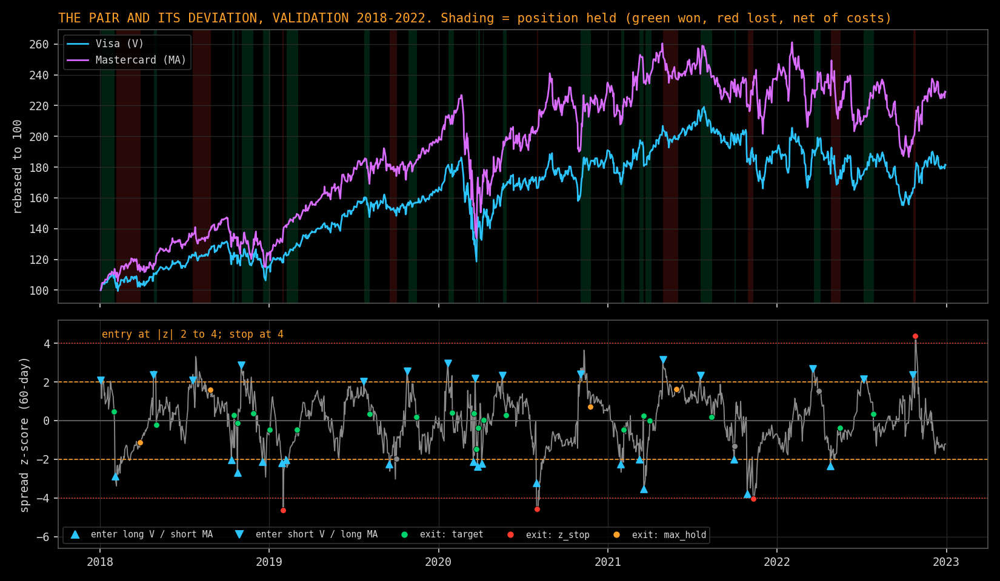
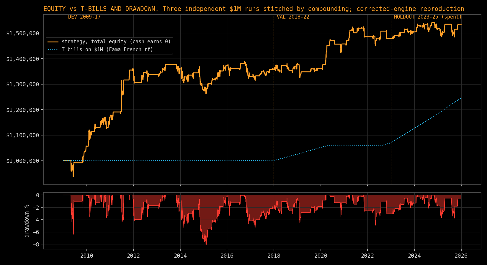
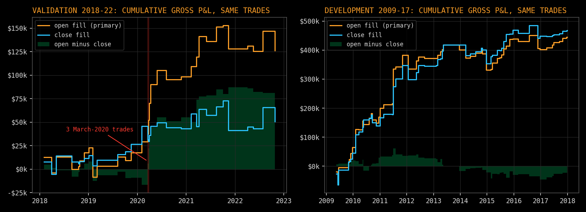
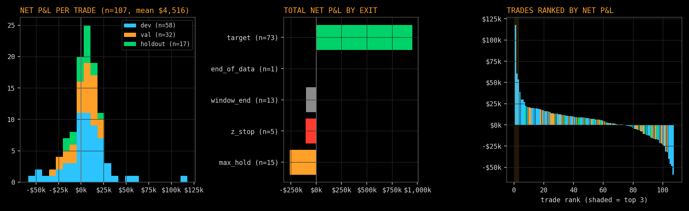

# V/MA Pairs Trading: A Walk-Forward Study

**Question.** Does the log-price spread between Visa (V) and Mastercard (MA) mean-revert tradably out of sample, after
execution timing, costs, borrow and dividends?

**Principal findings** (CRSP daily data, 2009-2025; details and caveats in [`docs/RESULTS.md`](docs/RESULTS.md))
- Net Sharpe 0.60 / 0.47 / 0.40 in development / validation / holdout, on total equity with cash earning nothing. Only the
  development period, which the design was checked on, is individually distinguishable from zero. For 2018-2025 the
  Sharpe is 0.44 (Newey-West t about 1.3).
- Against T-bill rates the as-run return is below cash in 2018-2025 (excess Sharpe -0.33); it exceeds cash only under
  explicit, unobservable financing assumptions.
- The validation result depends on the fill convention (Sharpe 0.47 at the next open vs 0.09 at the next close). Three March
  2020 trades account for $50.7k of the $75.6k gross difference. This sample does not establish a persistent opening-fill
  advantage.
- Without its three best trades the holdout loses money. Trades that touch an earnings window did worse (post-hoc, exploratory,
  interval includes zero).
- The accounting is internally consistent and was independently re-derived for six complete trades; the study is
  inconclusive about an economic edge. Final conclusion: [`docs/CONCLUSION.md`](docs/CONCLUSION.md).

**Important limitations.** One pair and about six trades per year; V and MA chosen with hindsight; execution at the opening
print with no impact model; assumed costs and borrow; every 2009-2025 year has now been examined, so none is untouched.

### Results at a glance
The first chart uses rebased V and MA price series from licensed CRSP data; the rest are strategy-level results only. All are reproductions with the corrected engine; the holdout is spent.


*Top: the two stocks rebased to 100 at the start of the validation period; shading marks when a position was held. Bottom: the
60-day z-score of the hedged log-price spread, which is the deviation the strategy trades. It enters when |z| is between 2 and
4, exits near 0.5, and stops out at 4. The fitted hedge ratio is re-estimated every 63 sessions, which is why the z-score
can jump at window boundaries.*


*Total-equity return (cash earns nothing in the strategy's account) against T-bills on the same $1M. The strategy's lead comes
from the 2009-17 development period, when T-bill rates were near zero (+35.8% vs 0.0%). In 2018-2025 (validation plus
holdout) the strategy compounded +12.9% and T-bills +24.6%; financing assumptions that could narrow that gap are in
`docs/RESULTS.md`. Periods are independent runs stitched for display.*


*Same trades, only the fill price differs. The validation-period advantage of opening fills comes mostly from three March 2020
trades, and the sign is reversed in development. This sample does not establish a persistent opening-fill advantage.*


*Many small target-exit wins and a fat left tail from time and stop exits. The three best trades matter: the holdout is
negative without them.*

An interactive version with prices, spread and case studies can be built locally (`make_dashboard.py`); it is not published
because it embeds licensed price data.

## Where to read
| document | content |
|---|---|
| [`docs/RESULTS.md`](docs/RESULTS.md) | all tables: runs, combined statistics, execution attribution, concentration, financing, earnings |
| [`docs/CONCLUSION.md`](docs/CONCLUSION.md) | what was tested, observed, remains uncertain, what would justify capital |
| [`docs/CASE_STUDIES.md`](docs/CASE_STUDIES.md) | three sourced trades, one deepened, decision-time facts separated from later information |
| [`docs/METHODOLOGY.md`](docs/METHODOLOGY.md) | design, execution and accounting conventions, evaluation discipline |
| [`docs/ACCOUNTING_AUDIT.md`](docs/ACCOUNTING_AUDIT.md), [`docs/PROVENANCE.md`](docs/PROVENANCE.md) | verification performed and its limits; code version and input checksums |
| [`docs/CORRECTIONS.md`](docs/CORRECTIONS.md), [`EXPERIMENTS.md`](EXPERIMENTS.md) | corrections with numerical effects; append-only run log |

## Design in one paragraph
Each 63-session window fits a hedge ratio on the prior 252 sessions, then trades the spread on a 60-day z-score: enter at
|z| in [2, 4), exit at |z| <= 0.5, signal stop at |z| >= 4, time stop at 3x the formation half-life (in sessions), exit
order at the window's last close. Signals use closes; orders fill at the next session's open (or next close as a declared
variant), so a window-end exit fills in the next window's first session. Positions are fixed share counts sized by the
cointegration hedge (notional of MA = beta x notional of V): not dollar-neutral and not market-beta-neutral. Risk limits: 5%
per-trade loss limit and a 20% drawdown halt. A share/cash ledger books costs, borrow and dividends; trade-level P&L must
reconcile to portfolio equity or the run fails.

## Reproduce
Tested with Python 3.10 and the versions in `requirements.txt`.
```bash
pip install -r requirements.txt
python -m pytest                          # 29 tests on synthetic fixtures; no data or credentials needed
python run_study.py --period synthetic    # engine demo on simulated data (not evidence)
```
With a WRDS account that includes CRSP, Compustat and Fama-French (licensed data stays out of Git; see `docs/DATA.md`):
```bash
pip install -r requirements-wrds.txt
python extract_wrds.py --check                         # schema and coverage; writes data/raw/wrds_manifest.json
python extract_wrds.py --format ciz --permno V=92611 MA=91233
python extract_aux.py                                  # risk-free, Compustat, CIZ cross-check fields, extraction log
python ingest.py                                       # data/processed/market.csv and quality report
python diagnostics/verify_data.py                      # validation and cross-checks
```
Reproduce the completed evaluations (clearly labelled as reproductions; the holdout was run once, earlier, and a re-run does
not make it fresh):
```bash
for r in "dev --gate none --fill open_next" "dev --gate coint --fill open_next" "dev --gate none --fill close_next" \
         "val --gate none --fill open_next" "val --gate coint --fill open_next" "val --gate none --fill close_next" \
         "holdout --gate none --fill open_next"; do python run_study.py --period $r --reproduce --out results_rerun; done
pip install -r requirements-viz.txt && python make_dashboard.py results_rerun   # interactive HTML dashboard into dashboard/ (local only)
python make_readme_figures.py results_rerun            # the three README figures into docs/img/ (strategy-level, no prices)
python make_figures.py results_rerun                 # spread/z-score, case-study and trade-P&L figures into figures/ (local only)
python make_public_results.py results_rerun            # tables, diagnostics output and figures into public_results/ (local only, git-ignored)
python diagnostics/attribution.py results_rerun        # open-vs-close attribution (also: pooled_stats, concentration,
python diagnostics/trade_audit.py results_rerun        #  earnings_analysis, case_valuation, compare_runs, provenance)
```
`run_study.py --period dev|val` and a first-ever `--period holdout --confirm <spec hash>` are the original evaluation commands;
they append to `EXPERIMENTS.md`, and the holdout is blocked by a lock file after one use.

## Layout
`config.py` frozen specification and hash; `signals.py` hedge fit and signal state machine; `engine.py` ledger, fills, costs,
borrow, dividends, risk limits; `metrics.py` statistics; `data_io.py`, `ingest.py`, `extract_wrds.py`, `extract_aux.py`
data; `run_study.py` evaluations; `case_studies.py`; `diagnostics/` verification and analysis scripts (importable; run with
a `main()` entry point); `tests/`; `docs/`.

Licence note: CRSP, Compustat and Fama-French data are licensed through WRDS; this repository contains no such data and
publishes only aggregate results derived from them.
